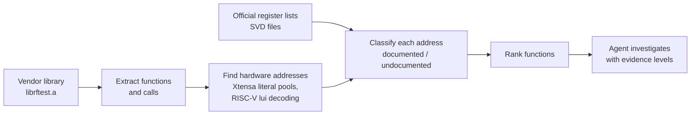

# ChipXray

**An X-ray for chips. ChipXray reads a chip maker's own firmware and finds hardware features they never documented.**

[](https://github.com/Om7035/chipxray/actions/workflows/tests.yml)


[](LICENSE)

---

## Why this exists

In September 2026, three groups found the same secret: **millions of $3 ESP32 chips hide a raw-radio mode** (a software-defined radio, or SDR). Espressif never documented it. The key was one function, `adctrig`, inside Espressif's public `librftest` library ([ESPARGOS write-up](https://espargos.net/espsdr/)).

People found it by hand, with an AI model helping them read machine code.

**ChipXray asks: can we make that discovery repeatable, automatic and measurable?**

## The goal

Give ChipXray a vendor library. Get back a ranked list of functions that touch undocumented hardware, with the evidence for each claim.

Then prove it works. ChipXray must re-find the hidden ESP32 radio mode **without being told where it is**. Three systems are compared:

| System | What it does |
|---|---|
| Rules only | Scores functions by the undocumented registers they touch. No AI. |
| One AI prompt | One model, one question, same inputs. |
| Evidence-driven agent | Investigates, tests competing explanations, and cites code addresses for every claim. |

Each system runs twice: with function names visible, and with names removed. The second run shows whether the system understands the code or only reads names.

## What it already shows

The three hardware addresses below are used by `adctrig` on the ESP32-S3. **None of them appear in Espressif's official register lists.** The fourth sets how internal SRAM is used, and ESPARGOS reports that the radio samples land in internal SRAM.

| Address | In the official register list? |
|---|---|
| `0x60033d5c` | No |
| `0x60033d60` | No |
| `0x6001c02c` | No |
| `0x600c101c` | Yes: `SENSITIVE.INTERNAL_SRAM_USAGE_3` |

The ESP32-C3 uses a different instruction set (RISC-V instead of Xtensa), but ChipXray resolves **the same three hidden addresses** there.

### Phase 1 result: rules only, no AI

| Chip | Functions | `adctrig` rank | inclusive rank | Documented test functions ranked above it |
|---|---|---|---|---|
| ESP32-C5 | 286 | **2** | 19 | 0 |
| ESP32-C61 | 252 | **2** | 29 | 0 |
| ESP32-S3 | 203 | 28 | 23 | 0 |
| ESP32-C3 | 218 | 29 | 27 | 0 |
| ESP32 | 289 | 30 | 58 | 0 |

Rules alone find it on two chips. On the other three, large radio functions outscore it, because the whole radio register space is undocumented. That gap is what the agent must close. Details: [results/baseline.md](results/baseline.md).

## How it works



Every finding gets one evidence level: **observed** (a fact in the binary) → **correlated** (several facts agree) → **inferred** (an interpretation) → **validated** (an independent source confirms it).

## Quick start

Needs Python 3.10+ and nothing else.

```bash
git clone https://github.com/Om7035/chipxray && cd chipxray
bash fetch_inputs.sh          # downloads pinned Espressif libraries + register lists, checks SHA-256

export PYTHONPATH=.
python -m chipxray.facts blobs/espressif/esp32s3_librftest.a                  # functions, calls, hardware addresses
python -m chipxray.baseline facts/esp32s3_librftest.json blobs/svd/esp32s3.svd  # ranked list -> results/
python tests/test_facts.py && python tests/test_svd.py && python tests/test_baseline.py
```

Add `--strip` to the first command to hide all function names (hard mode).

Optional: [Ghidra](https://ghidra-sre.org/) decompiles a function with `ghidra_scripts/DecompileFunction.java`.

## Roadmap

- [x] Extract functions, calls and hardware addresses from 5 ESP32 chips
- [x] Parse official register lists and classify every address
- [x] Rules-only baseline with negative controls
- [ ] Score functions together with the functions they call; export decompiled code
- [ ] Evidence-driven agent
- [ ] Benchmark: rules vs one prompt vs agent, names visible vs removed
- [ ] Transfer test on a chip family ChipXray never saw

## What ChipXray cannot prove

- Code that *configures* hidden hardware does not prove the hardware *works*. Only a test on a real chip can do that.
- The address finder reads instructions in order and ignores jumps, so it can miss or add some addresses.
- AI models trained after October 2026 may already know the ESP32 answer. Hard mode (names removed) and logging each model's training cutoff limit this risk.

## Inputs and credits

- Libraries: [espressif/esp-phy-lib](https://github.com/espressif/esp-phy-lib) (Apache-2.0), pinned at `20f1db05`. Not stored in this repo; `fetch_inputs.sh` downloads them.
- Register lists: [esp-rs/esp-pacs](https://github.com/esp-rs/esp-pacs), pinned at `fed196c2`.
- The ground truth comes from the [ESPARGOS](https://espargos.net/espsdr/) team's discovery.

## Independent reproduction and evaluation (2026-10-28)

See [EVALUATION-2026-10-28.md](EVALUATION-2026-10-28.md) for verified Windows build/test results, three real AI trials, a reproduced failure to recover `adctrig`, and two small portability/reporting fixes. Existing agent and benchmark modules have deterministic tests; that should not be confused with successful independent feature discovery.

## License

[MIT](LICENSE)
